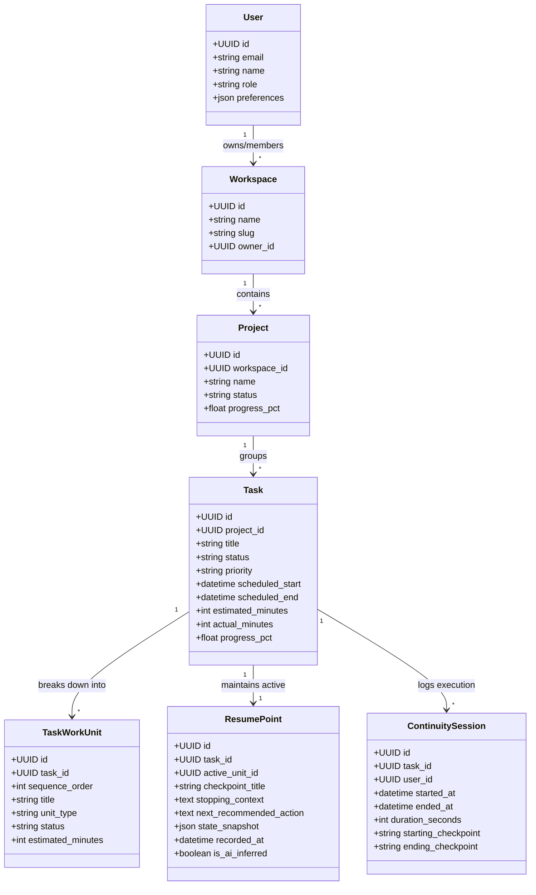

# Continuum: Scheduler & Work Continuity Platform
## Comprehensive Architecture & Technical Specification

---

### 1. Executive Summary & Core Philosophy

**Continuum** is an enterprise-grade Scheduler and Work Continuity Management Platform designed for students, professionals, developers, and distributed teams.

Traditional task managers (e.g., Todoist, Asana, Jira) suffer from the **"Context Amnesia"** problem: they track binary states (*To Do*, *In Progress*, *Done*), but shed all granular context when work is interrupted. When a user steps away from a complex task (debugging an authentication service, reading a 40-page chapter, drafting a grant proposal), returning requires high cognitive overhead just to reconstruct:
1. *What specific sub-component was active?*
2. *What exact artifact or page was open?*
3. *What was the immediate roadblock or thought process?*
4. *What is the exact single next step to take right now?*

**Core Product Axiom:**
> *"Plan the work. Execute the work. Remember where you stopped. Help you continue."*

Every scheduled task is modeled as a continuous, checkpointed workflow with deterministic state transitions, structured work breakdowns, checkpointed bookmarks, and an AI-assisted resume engine.

---

### 2. Requirements Analysis & Domain Model



---

### 3. Analysis of Ambiguities & Technical Risks

| # | Ambiguity / Technical Risk | Flawed Approach | Architected Robust Solution |
|---|---|---|---|
| **1** | **Automatic vs. Manual Resume Detection** | Invasive OS background spying or guessing from mouse activity. | **Deterministic Work Unit Hierarchy + Active Session Heartbeats**. Tasks have structured sub-units (e.g. Exercises 1–10, Modules 1–5). Completing unit $K$ automatically sets Unit $K+1$ as the prospective resume point. When the user stops a timer or exits a session, the system prompts for a 1-sentence "Stopping Note" with 1-click accept of the calculated resume point. |
| **2** | **AI Hallucination of Progress** | Giving the LLM unrestricted tool access to mark tasks "Done" based on ambiguous chat. | **Strict Read/Proposal Duality**. AI cannot mutate task status directly. It can only propose state transitions via structured JSON diffs that require user confirmation. The AI prompt explicitly enforces strict grounding: `"Only reference verified TaskWorkUnit records in the system context; never infer unrecorded completion."` |
| **3** | **Real-Time Collaboration Scalability** | Polling database every 2 seconds or syncing heavy video data through the app server. | **Dual-Tier Real-Time Pipeline**: Lightweight WebSocket event bus (for task status, typing, cursor presence, resume point notifications) + WebRTC Mesh Signaling for peer-to-peer 1:1 and small team voice/video calls without server media bottleneck. |
| **4** | **Complex Recurrence Scheduling** | Naively generating 1,000 future task rows in the database. | **RFC 5545 iCalendar (RRule) Specification**. Generate occurrences on-the-fly across requested date view windows (Day, Week, Month), and materialize task instances only when modified or executed. |

---

### 4. System Architecture & Component Topology

```
┌────────────────────────────────────────────────────────────────────────┐
│                        PRESENTATION TIER (SPA)                         │
│  React 19 + TypeScript + Modern CSS Glassmorphic Tokens + Lucide Icons │
│                                                                        │
│  ┌───────────────┐ ┌────────────────┐ ┌───────────────┐ ┌────────────┐ │
│  │   Dashboard   │ │   Scheduler    │ │  Continuity   │ │     AI     │ │
│  │ (Resume Hub)  │ │ (5-View Cal)   │ │ Engine Drawer │ │ Assistant  │ │
│  └───────────────┘ └────────────────┘ └───────────────┘ └────────────┘ │
└───────────────────────────────────┬────────────────────────────────────┘
                                    │ HTTP/REST + WebSocket (ws)
┌───────────────────────────────────▼────────────────────────────────────┐
│                         APPLICATION API TIER                           │
│                 Node.js 24 + Express + TypeScript                      │
│                                                                        │
│  ┌─────────────────┐ ┌───────────────────┐ ┌─────────────────────────┐ │
│  │ Auth & RBAC     │ │ Scheduling Engine │ │ Work Continuity Engine  │ │
│  │ JWT / Argon2id  │ │ RRule / DAG Calc  │ │ State Machine & Resume  │ │
│  └─────────────────┘ └───────────────────┘ └─────────────────────────┘ │
│  ┌─────────────────┐ ┌───────────────────┐ ┌─────────────────────────┐ │
│  │ AI Provider     │ │ Realtime Bus      │ │ Resource & File         │ │
│  │ Strategy Hub    │ │ WS Pub/Sub        │ │ Storage Engine          │ │
│  └─────────────────┘ └───────────────────┘ └─────────────────────────┘ │
└───────────────────────────────────┬────────────────────────────────────┘
                                    │ Relational Driver (WAL Mode)
┌───────────────────────────────────▼────────────────────────────────────┐
│                          PERSISTENCE TIER                              │
│       SQLite3 / DatabaseSync (Dev & Standalone) -> Postgres (Prod)     │
│   Normalized 18-Table Schema with Foreign Keys, Cascades, and Indexes  │
└────────────────────────────────────────────────────────────────────────┘
```

---

### 5. Work Continuity & Resume Point Engine Algorithm

#### Task State Machine
```
[Scheduled / Not Started]
         │
         ▼ (Start Session)
   [In Progress] ◄──────────────────────┐
    │          │                         │
    │ (Pause/Exit)                       │ (Resume from Checkpoint)
    ▼          ▼                         │
 [Paused]   [Interrupted] ───────────────┘
    │
    ▼ (All Work Units Complete)
[Completed]
```

#### Resume Point Computation Function
- **Step 1**: If task has structured work units $u_1, u_2, \dots, u_n$:
  - Look for first unit with status `in_progress`. If found, that is the current checkpoint.
  - Otherwise, look for the first unit with status `pending`. That is the next recommended action.
  - If all units are `completed`, mark task progress at 100% and transition state to `completed`.
- **Step 2**: Calculate completion percentage:
  $$\text{Progress} = \left(\frac{\text{Completed Units Count}}{\text{Total Units Count}}\right) \times 100$$
- **Step 3**: Store snapshot in `resume_points`:
  - `active_unit_id`
  - `checkpoint_title`
  - `stopping_context` (user-recorded or inferred note)
  - `next_recommended_action`
  - `state_snapshot` (serialized JSON of task metadata, active files, and timers)

---

### 6. Relational Database Schema Design

The normalized schema comprises:
1. `users` (id, email, password_hash, full_name, avatar_url, role, timezone, created_at, updated_at)
2. `workspaces` (id, name, slug, owner_id, description, settings, created_at, updated_at)
3. `workspace_members` (id, workspace_id, user_id, role, joined_at)
4. `projects` (id, workspace_id, name, description, color, status, target_end_date, progress_pct, created_at, updated_at)
5. `project_members` (id, project_id, user_id, role)
6. `tasks` (id, project_id, creator_id, assignee_id, title, description, priority, status, category, scheduled_start, scheduled_end, estimated_minutes, actual_minutes, recurrence_rule, progress_pct, created_at, updated_at)
7. `task_work_units` (id, task_id, sequence_order, title, unit_type, status, estimated_minutes, completed_at, created_at)
8. `task_dependencies` (id, task_id, depends_on_task_id, dependency_type)
9. `resume_points` (id, task_id, active_unit_id, checkpoint_title, stopping_context, next_recommended_action, state_snapshot, is_ai_inferred, updated_at)
10. `continuity_sessions` (id, task_id, user_id, started_at, paused_at, ended_at, duration_seconds, start_checkpoint, end_checkpoint, notes)
11. `learning_materials` (id, task_id, project_id, uploader_id, title, resource_type, file_path, url, metadata, created_at)
12. `comments` (id, target_type, target_id, user_id, content, created_at, updated_at)
13. `chat_channels` (id, workspace_id, project_id, name, channel_type, created_at)
14. `chat_messages` (id, channel_id, sender_id, message_type, content, attachments, reply_to_id, created_at)
15. `notifications` (id, user_id, type, title, message, action_url, is_read, created_at)
16. `ai_conversations` (id, user_id, workspace_id, title, context_scope, created_at)
17. `ai_messages` (id, conversation_id, sender_type, content, tool_calls, grounding_metadata, created_at)
18. `activity_logs` (id, workspace_id, user_id, action, entity_type, entity_id, payload, created_at)

---

### 7. AI Abstraction Architecture

An extensible strategy pattern that isolates AI vendors:
```typescript
interface AIAssistantProvider {
  generateResponse(prompt: string, context: GroundingContext): Promise<AIResponse>;
  proposeTaskBreakdown(goal: string, timeFrameMinutes: number): Promise<TaskWorkUnitDraft[]>;
  generateResumeRecommendation(taskState: TaskContinuityState): Promise<ResumeGuidance>;
  summarizeResource(content: string, mimeType: string): Promise<string>;
}
```
Available providers:
- `GeminiProvider` (Google Gemini 1.5/2.0 API via `@google/genai`)
- `OpenAIProvider` (OpenAI GPT-4o / Compatible REST)
- `MockProvider` (High-fidelity heuristic engine for development, offline usage, and deterministic test runs)

---

### 8. Technology Stack Decision Matrix

- **Backend Platform**: Node.js 24 LTS + TypeScript.
- **API Framework**: Express.js with custom typed controllers, standard error middleware, and security headers (Helmet, CORS).
- **Database Engine**: SQLite with WAL mode via `node:sqlite` / SQLite3 driver (zero friction, immediate zero-config setup on Windows, perfectly suited for high-speed local and staging environments, seamlessly portable to PostgreSQL for distributed enterprise setups).
- **Real-Time Layer**: WebSocket server (`ws`) handling live session heartbeats, chat broadcast, and WebRTC peer signaling.
- **Frontend Architecture**: React 19 + TypeScript + Vite + custom Vanilla CSS Design Tokens (rich dark/light themes, glassmorphism, fluid typography, smooth micro-interactions).
- **Mobile Engine**: Capacitor 8 Native Bridge (iOS & Android) with unified codebase, native haptics, status bar control, Android hardware back-button handling, and thumb-friendly mobile bottom navigation.
- **Testing**: Vitest + Supertest for robust unit and API integration testing.

---

### 9. Mobile App Architecture (Capacitor Native Platform)

```
┌────────────────────────────────────────────────────────────────────────┐
│                        NATIVE MOBILE CONTAINER                         │
│                    iOS (WebKit) / Android (Chromium)                   │
├────────────────────────────────────────────────────────────────────────┤
│  ┌──────────────────────────────────────────────────────────────────┐  │
│  │                    PRESENTATION LAYER (SPA)                      │  │
│  │  React 19 + Vite + Mobile Bottom Navigation + Safe Area Insets  │  │
│  │                                                                  │  │
│  │  ┌───────────────┐ ┌────────────────┐ ┌───────────────────────┐  │  │
│  │  │  Home / Deck  │ │   Schedule     │ │ Continuity Drawer Hub │  │  │
│  │  └───────────────┘ └────────────────┘ └───────────────────────┘  │  │
│  │  ┌───────────────┐ ┌────────────────┐ ┌───────────────────────┐  │  │
│  │  │ AI Assistant  │ │  More Modules  │ │ Checkpoint Quick-Card │  │  │
│  │  └───────────────┘ └────────────────┘ └───────────────────────┘  │  │
│  └──────────────────────────────────┬───────────────────────────────┘  │
│                                     │ Capacitor JS Bridge              │
├─────────────────────────────────────▼──────────────────────────────────┤
│                       NATIVE HARDWARE PLUGINS                          │
│  • @capacitor/status-bar (Dark theme & notch integration)              │
│  • @capacitor/haptics (Vibration on checkpoint toggle & pause)         │
│  • @capacitor/app (Lifecycle pause/resume & Android back button)       │
│  • WebRTC P2P (Camera, microphone & audio hardware access)             │
└─────────────────────────────────────┬──────────────────────────────────┘
                                      │ REST API / WebSocket
┌─────────────────────────────────────▼──────────────────────────────────┐
│                   CONTINUUM BACKEND API SERVICE (Node 24)              │
└────────────────────────────────────────────────────────────────────────┘
```

#### Mobile Touch Patterns & Ergonomics
1. **Thumb-Zone Navigation (`MobileBottomNav`)**:
   - Replaces the desktop sidebar on screens $\le 768\text{px}$ or native mobile devices.
   - Fixed to the bottom with `env(safe-area-inset-bottom)` to accommodate iOS home indicator bars.
   - Quick tabs: Home, Schedule, Floating AI button, Continuity Hub (with live resume counter badge), and More.
2. **Tactile Feedback (`MobileBridge`)**:
   - Light haptic tap on navigation switching.
   - Success vibration sequence upon completing a work unit or exercise.
   - Medium impact haptic when pausing a timer and persisting a stopping checkpoint.
3. **Bottom Sheet Drawer Adaptation**:
   - The interactive Continuity execution drawer and task creator slide up as touch-friendly bottom sheets on mobile devices.

